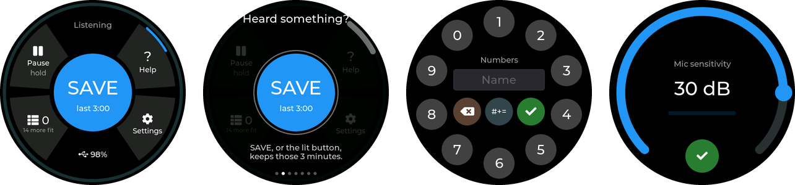

# Round Recorder



**Rewind the last three minutes.** Firmware that turns the Waveshare
ESP32-S3-Touch-AMOLED-1.75C, a round 1.75" AMOLED board, into a pocket voice
recorder. It always holds the last three minutes in memory, and one press
saves them, so the idea you just had, or what someone just said, is kept
after the fact.

- **Nothing is kept unless you save it.** The three minutes go round in
  memory and are written over as they go; only a save writes to flash.
- **Offline.** No Wi-Fi, no Bluetooth, no account. Recordings leave the board
  only over USB, as WAV files, to your own laptop, with transcripts made
  there by Whisper if you like.
- **One press,** on the screen or on the side button with the board in a
  pocket. Keep recording carries on from the save, as one recording.
- **Made for a round screen:** buttons that fill the circle, lists that
  scroll like a watch's, a phone keypad bent round the rim for names, and a
  player with its progress on the rim and 1.5x or 2x speed at the same
  pitch.

Recording people can need their consent where you live: check before you
use it on others.

## What you need

- A [Waveshare ESP32-S3-Touch-AMOLED-1.75C](https://www.waveshare.com/esp32-s3-touch-amoled-1.75c.htm)
  (the C variant, with two microphones and a speaker; other variants are
  untested).
- A USB-C data cable.
- For use away from USB, a LiPo battery for the board's battery connector.

## Installing it

In Chrome or Edge on a laptop, open the
[web installer](https://gurselm.github.io/round-recorder/), plug the board in
and press Install. Nothing to set up; it replaces the firmware the board came
with. Or build it yourself (see "Building and flashing").

## Using it

- **SAVE** (the big button, or a tap of the top button, PWR) keeps the last
  three minutes as a recording. Saves don't overlap: the next one keeps only
  what's come since, so SAVE shows how much that is ("last 46 s"), or
  "nothing new" right after a save, when a tap only sounds the low pair.
- **Keep recording:** right after a save, the screen offers it first, or
  press PWR again within 10 s. The recording carries on from the save, as one
  recording, with the ring red and its length counting, until STOP (the big
  button, or PWR), or 15 minutes.
- Two notes sound for each: rising as a recording starts, falling as it
  stops, the same note twice for a save, and a low pair if a save failed or
  the battery is low.
- **Top button (PWR)** does what the big button shows. A save from PWR asks
  for no name, in case it's in a pocket. Hold it 3 s to power off, which ends
  a recording first; press to power on, and it starts listening again.
  Holding it 10 s cuts the power whatever the firmware is doing.
- **Bottom button (BOOT):** screen on or off. The screen turns itself off
  after 15 s without a touch. With the always-on ring (Settings, on at
  first), it doesn't go black: a dim ring stays round the rim, grey while
  listening, red while recording, so it's plain it's working; with Tap to
  wake, a tap on it wakes the screen. The first time, a screen says what the
  two buttons do.
- **Screen:** laid out for a round screen. SAVE is the round button in the
  middle, with how much it would keep inside it. Round it, four bands fill
  the circle: on the left your audio, Pause above and the recordings below
  (how many, big, and how many more saves fit: amber at the last one; Full
  in amber once saves replace the oldest, in red when every one is
  protected and a save can't); on the right the device, Help above and Settings below, beside the
  side buttons, where a finger brushing the screen only opens something.
  What's going on reads above them, the battery below. The ring around the
  rim moves with the sound while listening, sweeps while saving and fills
  red while recording. A short arc beside PWR takes SAVE's colour (blue,
  red while recording, amber while paused): that button does what SAVE
  does. The battery shows the hours left once it has run down 3 % off USB,
  and warns at 15 %.
- **Pause** takes a hold: the band fills amber, then it stops listening. A
  tap only says to hold it. Paused, SAVE and the band both say RESUME, and
  a tap on either, or on PWR, listens again.
- **Help (?):** the first time, a tour of the main screen: seven steps, each
  lighting the control it's about (the side buttons light on the rim beside
  them) and dimming the rest. Tap for the next step, swipe right for the one
  before; the screen stays on meanwhile. After that, ? opens Help: How to use
  (the tour again), then every button and gesture by topic: the top and
  bottom buttons, the main screen, recordings, playing, naming, the laptop.
- **Back:** swipe right, or the Back button.
- **A recording:** tap it in the list. Its progress runs around the rim (drag
  it to jump), with play/pause, back and forward 10 s, quieter and louder
  (the speaker's volume, kept as Settings keeps it), and 1x, 1.5x or 2x
  speed, which speeds up speech without raising its pitch. More has Protect,
  Name and Delete; holding a recording in the list goes there too. Protected,
  no save ever replaces it. After a delete, the list offers Undo for 6 s.
- **Delete downloaded** and **Delete all**, at the end of the list, each ask
  first. Delete downloaded takes those already on the laptop; Delete all takes
  every one, saying how many aren't downloaded yet. Both keep protected ones
  and one still being recorded. Delete downloaded shows once any are
  downloaded, Delete all while any aren't.
- **The list** shows each recording's loudness faintly behind its row, a
  disk for protected ones and a tick for those already downloaded. Before the
  clock is set (by pull.py), this boot's recordings still say how long ago.
- **After a save** from the screen: Keep recording, Protect, a name (one of
  eight, Idea, To-do, Meeting and so on, or typed), or Done. 20 s without a
  touch leaves it as it is. Names show in the list and go into the WAV names.
- **Typing a name** is on a phone keypad bent round the rim, ten round keys:
  tap a key again for its next letter (abc, then its digit), pause or tap
  another key to go on. The first letter comes out capital. Delete, in the
  middle, takes a letter, held it takes them all; the green key saves the
  name. The key between them switches to numbers (1 to 9, 0 round the ring
  from the top) and symbols (& + # @ ( ) / : _ %), one press each. For long names, `pull.py --name` is quicker.
- **Lists** (recordings, Settings, Help, naming) scroll as on a round watch:
  the row in the middle is the one you're on, and rows narrow with the circle
  and fade toward the edges.
- **When it's full**, a save replaces the oldest recording that isn't
  protected. If every slot holds a protected one, Save shows FULL: delete one
  or unprotect it.
- **Low battery:** off USB at 3 %, it saves what it's holding (or ends the
  recording going on) and powers off, so a flat battery doesn't lose it.
- **Settings:** mic sensitivity, speaker volume, brightness and how soon the
  screen turns off each open a dial: drag round the rim, the value in the
  middle (mic sensitivity shows a level; volume beeps when you let go). Then
  sounds, the always-on ring, tap to wake and standby when quiet, on or off;
  storage (used,
  protected, downloaded); and Power off. Changes take effect at once and are kept across restarts.

There are 20 slots of 3 minutes each, an hour in all. A recording longer than that is written in
3-minute parts, a slot each, and always leaves one slot free for the others.

On battery it records until you power it off or the battery runs out. With
USB plugged in it charges while it records.

The board has no real-time clock. Running `pull.py` sets the clock, which
then lasts until the power goes, so clips saved after that carry their date
and time. Clips saved before it are named by their number.

## Battery life

While it listens the chip can't sleep: the I2S that reads the mics keeps it
awake at 80 MHz or more. Measured on one board, listening with the screen
off nearly all the time: 5 h 57 min from full to the power-off at 3 %. The
screen adds a lot while it's on, so let it time out.

**Standby when quiet** (Settings, off until you turn it on): off USB, after
10 minutes with no sound to speak of (a click, a knock or a cough alone
doesn't count, only a second with sound through it) and the board not moved
(the QMI8658 motion sensor), the chip sleeps, waking after 1 s, then 2 s,
then every 4 s, to listen for a quarter of a second. Sound, moving the
board, USB or a button has it listening again at once. Meanwhile the screen
is fully dark, the dim ring included, and the ring is back after. What it
held before stays, but the start of what wakes it, up to about 4 s, isn't
kept. The battery log marks the minutes in standby, so `pull.py --battery`
shows what it saves.

The percent doesn't fall evenly: in that run the top half lasted 4.5 hours
and the bottom half under 1.5. The hours left on the screen allow for that,
from that run's curve, scaled to how fast your board is going.

To measure your own: charge it, unplug it, and use it or leave it until it
powers itself off at 3 %. Plug it back in (before turning it on, or it
carries on logging), then:

```sh
python3 tools/pull.py --battery                     # how long it lasted, and the drain per hour
python3 tools/pull.py --battery --battery-csv b.csv # and every entry, for a chart
```

From each time it comes off USB, the board notes its battery's voltage and
percent once a minute, and whether the screen was on or a recording going,
in flash past the last recording slot, so the power-off doesn't lose it.

## Getting the clips

Plug the board in with a data cable, then:

```sh
python3 tools/pull.py              # new recordings into ./recordings, and sets the clock
python3 tools/pull.py --list
python3 tools/pull.py --delete     # also delete each from the board once it's saved here, except protected ones
python3 tools/pull.py --name 4 "Call with Sam"   # name recording 4; --list shows the numbers
python3 tools/pull.py --protect 4  # or --unprotect 4
```

Files are named by when the recording was saved, its number, and its name,
such as `2026-11-05_10-22-03_clip4_Call-with-Sam.wav`, with its parts joined
into one file. Renaming a recording after it's downloaded renames the file on
the next run instead of downloading it again. A recording still going on is
left for the next run.

Each one downloaded is marked on the board, which shows a tick for it, and
Delete downloaded, at the end of the recordings list, clears them off.

The tools are in this repository: download it (Code, Download ZIP on
GitHub) or clone it. They need Python 3 on Linux or macOS (they use the
serial port through termios, so not Windows yet).

For one click instead, `tools/sync.py` downloads what's new into
`~/Recordings/Round`, with transcripts if the `.venv` below has Whisper,
says how it went in a desktop notification, and opens the folder.
`tools/round-recorder.desktop` puts it in the Linux app menu (set its path).

Transcripts use Whisper on the laptop, no network after the model's first
download:

```sh
python3 -m venv .venv && .venv/bin/pip install faster-whisper
.venv/bin/python tools/pull.py --transcribe
```

Each WAV gets a `.txt` beside it, and a recording without a name gets the
transcript's first words in its file name. `RR_WHISPER_MODEL=small` is more
accurate than the default `base` but about four times slower (a minute for
three minutes of audio on this laptop); `RR_WHISPER_LANG=en` (or `tr`, ...)
stops Whisper guessing the language from the first 30 seconds.

With other ESP32 boards plugged in, pass the recorder's port, for example
`--port /dev/serial/by-id/usb-Espressif_USB_JTAG_serial_debug_unit_XX:XX:XX:XX:XX:XX-if00`
on Linux, or `--port /dev/cu.usbmodem1101` on macOS.
It only needs the Python standard library. Downloads run at about 2 seconds
per minute of audio, and each clip is checked against its CRC before it's
saved, or deleted with `--delete`.

## Building and flashing

With [ESP-IDF](https://docs.espressif.com/projects/esp-idf/en/stable/esp32s3/get-started/)
v6.0.1:

```sh
. ~/esp/esp-idf-v6/export.sh
idf.py build
idf.py -p /dev/ttyACM0 flash monitor
```

The first build fetches LVGL, the board support and the other components
into `managed_components/`. `idf.py merge-bin -o round-recorder.bin` makes
the single file the web installer uses, written at offset 0.

Build settings live under "Round recorder" in `idf.py menuconfig`: seconds
kept (10–300, 180 by default), the longest recording (900 s), the low-battery
charge (3 %), and the defaults for mic gain, playback volume, screen timeout
and sounds until they're changed in Settings on the board. Changing the
seconds changes the slot size, which can lose saved clips.

To see the screen without the board in front of you:

```sh
python3 tools/snap.py shot.png          # what it shows now, as a PNG
python3 tools/snap.py list.png list     # after opening a screen
python3 tools/snap.py --all shots/      # every screen
python3 tools/snap.py t.png settings --tap 233,233   # tap there, as a finger would, then take it
```

The screens are main, help, help-topic, list, settings, dial, confirm, delete-all, delete-downloaded, name,
keyboard (keyboard-123 and keyboard-sym for its other modes), manage, player, intro, aod and tour (tour0 to tour6 for each step).
LVGL renders the screenshot into PSRAM, so it costs nothing until it's used.

## How it works

- `main/rec_ring.c`: the last three minutes in PSRAM as 20 ms IMA ADPCM
  blocks (about 1.5 MB). Each block carries its own encoder state, so any run
  of blocks decodes on its own. A save copies it a piece at a time while
  recording goes on.
- `main/rec_store.c`: clips in the `clips` partition, one per 1.4 MB slot.
  A clip's name and flags (protected, downloaded) are a small record in the
  rest of its header sector, which changing them appends to without erasing,
  so a power cut keeps what they were. The save also leaves one record there
  of its own: the clip's loudness, from each block's encoder step, and when
  it was saved by the board's count since boot. Deleting erases only the
  header sector, which is what lets Undo write it back while the audio is
  untouched. A save erases the slot, writes the blocks, then the header, so a
  power cut mid-save leaves no clip rather than a broken one.
- `main/rec_proto.c`: the line protocol `pull.py` speaks over the USB serial
  port, alongside the logs.
- `main/recorder.c`: the audio, save and playback tasks around them. A
  recording goes to flash a part at a time, each time the ring is 5 s from
  losing what isn't saved yet.
  `main/ui.c` is the LVGL screen, `main/audio.c` the codecs, and
  `main/settings.c` keeps the settings in NVS.
- `main/tempo.c`: faster playback at the same pitch (WSOLA).
- `main/multitap.c`: the naming keypad's typing.

`rec_ring.c`, `rec_store.c`, `rec_proto.c`, `tempo.c` and `multitap.c` have no
ESP-IDF code in them, and the host tests compile them:

```sh
python3 -m unittest discover -s tests
```

The tests cover the ring (including a save's piecewise copy while recording
goes on), faster playback (length, pitch and loudness), recordings in parts
and which clip a save replaces, the store (with flash that refuses writes to bytes
that weren't erased, and a power cut mid-save), and `pull.py` end to end
against a fake board on a pseudo-terminal.

## Known limits

- The clock is lost at power-off, so clips saved before the next `pull.py`
  have no time.
- Playback goes into the recording too, since the mics keep listening.
- Pause stops filling the ring, but not the mics. The board draws the same
  power paused.

## License

MIT, see `LICENSE`. The firmware also contains ESP-IDF, LVGL, Waveshare's
board support and other components under their own licenses, listed in
`THIRD_PARTY_NOTICES.md`.
